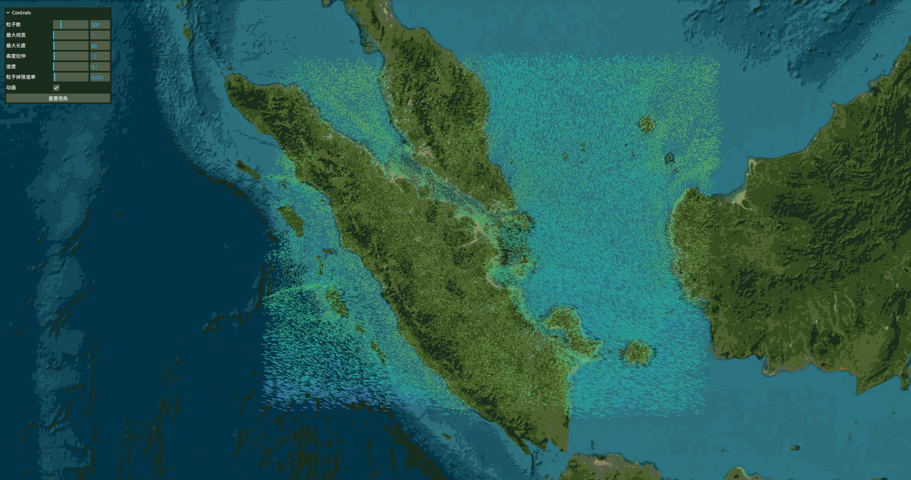
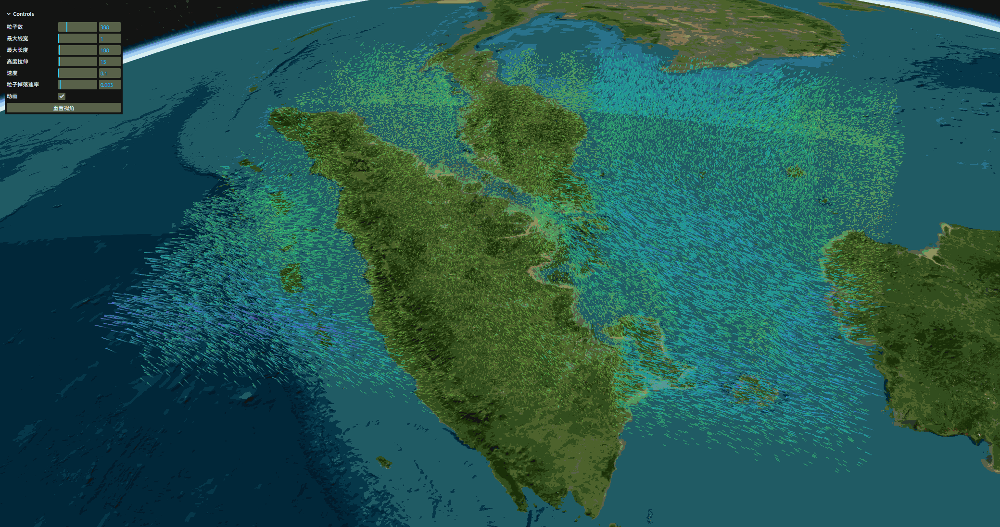

# cesium-wind-layer-3d

基于 WebGL2 的 CesiumJS 三维风场图层，使用 3D 纹理 + GPU 粒子平流（GPGPU）实现高性能动态风场可视化。

> 注意：这是 **3D 风场** 独立包，在 2D 风场包 [`cesium-wind-layer`](https://www.npmjs.com/package/cesium-wind-layer) 基础上增加了垂直 `w` 分量，实现真正的三维风场。本包数据为 `(u, v, w)` 三分量三维网格，粒子在三维空间平流。


## 效果

<table>
  <tr>
    <td></td>
    <td></td>
  </tr>
</table>


## 特性

- WebGL2 原生 3D 纹理（`sampler3D`）存储风场，硬件三线性插值采样
- GPU 粒子平流（Runge-Kutta 2），数百万粒子实时流动
- 速度自适应线宽/线长，色带映射
- 运行时动态替换数据、调参、显隐
- 2D / 3D 场景模式均支持
- 浏览器本地加载 NetCDF-3，缺少垂直风速时可自动补零
- 按风速连续着色，并支持高速区域粒子加权加密
- 同时加载多个二维和三维风场，二维文件可按不同高度叠加
- 三维风场支持全部高度、连续高度范围和离散单层显示
- 网页默认列出 `tools/converted/` 中的风场文件
- 使用 Docker CTB 处理并加载本地 quantized-mesh DEM 地形

## 安装

```bash
npm install cesium-wind-layer-3d
```

`cesium` 为 peer dependency，请确保已安装 CesiumJS（^1.142.0）。

## 快速开始

```js
import * as Cesium from "cesium";
import { WindLayer3D } from "cesium-wind-layer-3d";

const viewer = new Cesium.Viewer("container");

const windData = {
  u: { array: uArray },   // Float32Array(nx*ny*nz)
  v: { array: vArray },
  w: { array: wArray },
  nx, ny, nz,
  bounds: { west, south, east, north },
  levels: [500, 1500, 3000, 5500], // 每层高度(米)，升序
};

const layer = new WindLayer3D(viewer, windData, {
  colors: ["rgb(175,240,91)", "rgb(110,64,170)"],
  particlesTextureSize: 256,
});

layer.zoomTo(2);
```
---
## 项目目录
src/
  core/             公共图元、工具和着色器管理
  wind-2d/          二维固定高度风场
  wind-3d/          三维风场与高度范围
  data/             NetCDF 读取和数据规范化
  layers/           多风场图层管理
  terrain/          本地 DEM 地形提供器
  rendering/        GPU 计算与绘制
  shaders/          GLSL 着色器

example/
  app/              页面入口
  ui/               GUI 控件
  services/         本地服务客户端
  data/             示例数据

tools/
  server/           本地 HTTP 服务
  netcdf/           NetCDF 转换工具
  terrain/          DEM 处理工具
  converted/        处理后的风场文件
  terrain-output/   处理后的地形数据

docs/
  更新日志.md
  项目结构.md
  数据格式.md

## 数据契约

### WindData3D

| 字段 | 类型 | 说明 |
|------|------|------|
| `u` / `v` / `w` | `{ array: Float32Array }` | 东/北/垂直风速分量 (m/s)，长度 `nx*ny*nz` |
| `speed` | `{ array, min, max }` | 可选，缺省由 u/v/w 自动合成 |
| `nx` / `ny` / `nz` | `number` | 经度/纬度/垂直层网格数 |
| `bounds` | `{ west, south, east, north }` | 数据范围（度） |
| `levels` | `number[]` | 每层高度(米)，升序，长度 `nz` |

数组布局：`index = (z * ny + y) * nx + x`，x=经度(西→东)，y=纬度(南→北)，z=层(低→高)。

### 加载 NetCDF-3

```js
import { loadNetCDF3File, WindLayer3D } from "cesium-wind-layer-3d";

const { windData, metadata } = await loadNetCDF3File(file);
const layer = new WindLayer3D(viewer, windData);
console.log(metadata.warnings);
```

加载器自动识别常见的 `lon/lat/lev` 与 `U/V/W` 变量名，将经纬度和高度统一为升序，
并把数据重排为 `(lev, lat, lon)`。缺少 `W` 时使用 `0 m/s`；压力层必须先转换为米制高度。
浏览器加载上限默认是 150 MB。

NetCDF-4/HDF5 需先转换：

```powershell
py -m pip install xarray numpy netCDF4
py tools\netcdf\convert_netcdf.py "D:\data\wind.nc"
```

转换器的变量名、时间索引等参数参见 [`tools/NETCDF.md`](tools/NETCDF.md)。

### GUI 转换 NetCDF-4

示例页面的“工具”页可以调用本地 Python 服务转换用户选择的 NC 文件：

```powershell
npm run local:server
```

服务仅监听 `127.0.0.1:8765`。转换后的文件保存在 `tools/converted/`，GUI 会显示处理结果和完整保存路径。
浏览器客户端位于 `example/services/localServiceClient.js`，服务逻辑位于 `tools/server/local_service.py`。

同一个服务还会列出 `tools/converted/` 中的文件，因此点击“加载二维风场”或“加载三维风场”时，网页会先显示该目录，再提供“浏览其他位置”入口。

### 本地 DEM 地形

DEM 使用 Docker 中的 Cesium Terrain Builder 转为标准 quantized-mesh：
#### 使用前需要下载Docker Desktop。
1. 确认是否已安装 Docker
在 Windows 上，推荐使用 Docker Desktop for Windows。
检查开始菜单或 C:\Program Files\Docker 目录下是否有 Docker Desktop。
如果未安装，请前往官网下载并安装：https://www.docker.com/products/docker-desktop/

-----
```powershell
npm run local:server
```

在 GUI“工具”页选择 GeoTIFF、IMG、ASC 或 DEM 文件。服务会调用 GDAL 重投影到 EPSG:4326，再使用 `tumgis/ctb-quantized-mesh:latest` 生成地形。输出保存在 `tools/terrain-output/`，可在“图层”页加载。

### Cesium 服务配置

示例所需 token 集中保存在 `example/config/serviceTokens.js`。该文件已加入 `.gitignore`；
可参考 `example/config/serviceTokens.example.js` 添加 Cesium ion、天地图或其他服务凭据。

## 选项 WindLayerOptions

| 字段 | 默认值 | 说明 |
|------|--------|------|
| `particlesTextureSize` | `128` | 粒子纹理尺寸，粒子总数 = size² |
| `dropRate` | `0.003` | 基础丢弃率 |
| `dropRateBump` | `0.01` | 速度相关丢弃增量 |
| `speedFactor` | `1.0` | 速度缩放 |
| `lineWidth` | `{ min: 1, max: 2 }` | 线宽范围（像素） |
| `lineLength` | `{ min: 20, max: 100 }` | 线长范围 |
| `heightScale` | `1` | 高度拉伸 |
| `colors` | `["white"]` | 色带 CSS 颜色数组 |
| `flipY` | `false` | 翻转 Y 轴 |
| `useViewerBounds` | `false` | 在视口范围播种粒子 |
| `domain` | `undefined` | 色带映射域 |
| `displayRange` | `undefined` | 显示范围 |
| `lowSpeedOpacity` | `0.72` | 低速流线的最低透明度，越大越显眼 |
| `densityBySpeed` | `true` | 是否把更多粒子播种到高速区域 |
| `densityExponent` | `1.5` | 高速区域加密强度 |
| `densityFloor` | `0.15` | 低速区域保留的最低采样权重 |
| `verticalMode` | `"all"` | `all`、`range`、`level` 或二维内部使用的 `fixed` |
| `heightRange` | `undefined` | 连续高度范围 `{ min, max }`，单位米 |
| `selectedLevel` | `undefined` | 离散单层模式选择的真实高度，单位米 |
| `fixedHeight` | `undefined` | 二维风场的固定显示高度，单位米 |
| `dynamic` | `true` | 是否动态更新 |

## API

| 方法 | 说明 |
|------|------|
| `show` | 读写属性，控制显隐 |
| `updateWindData(data)` | 运行时替换风场数据 |
| `updateOptions(options)` | 运行时更新参数 |
| `zoomTo(duration?)` | 飞到数据范围 |
| `destroy()` | 销毁全部资源 |
| `isDestroyed()` | 是否已销毁 |

## 示例

```bash
git clone https://github.com/lby0102/cesium-wind-layer-3d.git
cd cesium-wind-layer-3d
npm install
npm run build
npm run dev
```

浏览器打开 Vite 输出的本地地址即可使用多层风场和地形 GUI。完整目录说明见 [`docs/项目结构.md`](docs/项目结构.md)，每次更新见 [`docs/更新日志.md`](docs/更新日志.md)。

## 浏览器要求

- WebGL2（CesiumJS 1.104+ 默认启用）
- 需要 `EXT_color_buffer_float`（浮点纹理渲染）与原生 3D 纹理支持

## License

MIT
